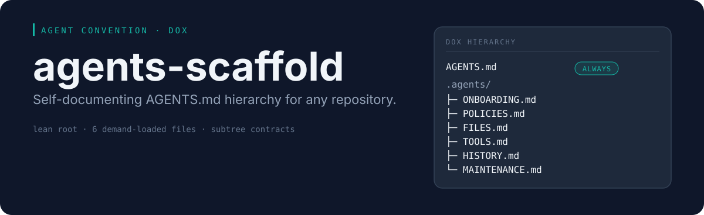
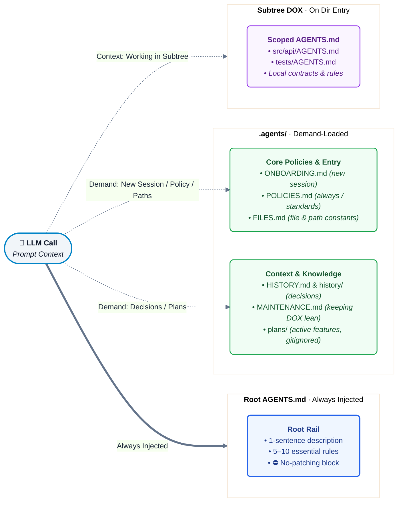

# agents-scaffold

<p align="center">
  
</p>

> **AGENTS.md is for agents, not humans.** One sentence of project
> description, then rules. Everything else is demand-loaded.

**agents-scaffold** ships a copy-paste convention for keeping
`AGENTS.md` lean. The root file holds only the rules every LLM call
needs; everything else lives in `.agents/` files (loaded on demand)
or subtree `AGENTS.md` files (loaded on directory entry).

## Problem

`AGENTS.md` is injected on every LLM call. Most files are bloated with
tree views, history entries, TODO lists, and verbose descriptions — all
things the agent can discover on demand. Every redundant byte dilutes
the signal-to-noise ratio of every call.

## Mechanism



## Quick start

### Manual Integration

1. Copy `AGENTS.md`, `.agents/`, and `INSTALL.md` into any repository.
2. Fill `AGENTS.md` §2–4: one-sentence description, 5–10 always-on rules, child DOX index.
3. Feed `INSTALL.md` to your agent — it performs the full migration.

See [`INSTALL.md`](./INSTALL.md) for the complete migration checklist.

### Agent Setup

Pipe `INSTALL.md` straight from this repo into your coding agent and let it perform the migration autonomously:

```bash
# macOS / Linux
curl -fsSL https://codeberg.org/jr2804/agents-scaffold/raw/branch/main/INSTALL.md | <agent-cli>

# Windows (PowerShell)
irm https://codeberg.org/jr2804/agents-scaffold/raw/branch/main/INSTALL.md | <agent-cli>
```

Adapt `<agent-cli>` to your tool's prompt-from-stdin entry point (e.g. Claude Code, opencode, aider, fabric).

Or paste this single instruction into any agent:

```text
Please install or update the framework given in https://codeberg.org/jr2804/agents-scaffold/raw/branch/main/INSTALL.md
```

## Principles

| Principle                           | Why it matters                                                            |
| ----------------------------------- | ------------------------------------------------------------------------- |
| AGENTS.md is for agents, not humans | Max signal density on every call                                          |
| No tree views                       | Generate on demand: `rg --files \| tree-cli --fromfile`                   |
| No history                          | Git log has it; only record decisions costly to rediscover                |
| No TODO lists                       | Use an issue tracker or `beads`                                           |
| DOX hierarchy                       | Subtree AGENTS.md files own local contracts; root stays lean              |
| ⛔ No Patching                      | Content appended after the blocker section is invalid and must be removed |

## Credits

- Base convention: [dox](https://github.com/agent0ai/dox) — self-documenting AGENTS.md hierarchy.
- Extended with structured `.agents/` files and anti-bloat patterns from [knox](https://github.com/anomalyco/knox).

<p align="center">
  <a href="https://github.com/oil-oil/beautify-github-readme"></a>
</p>
